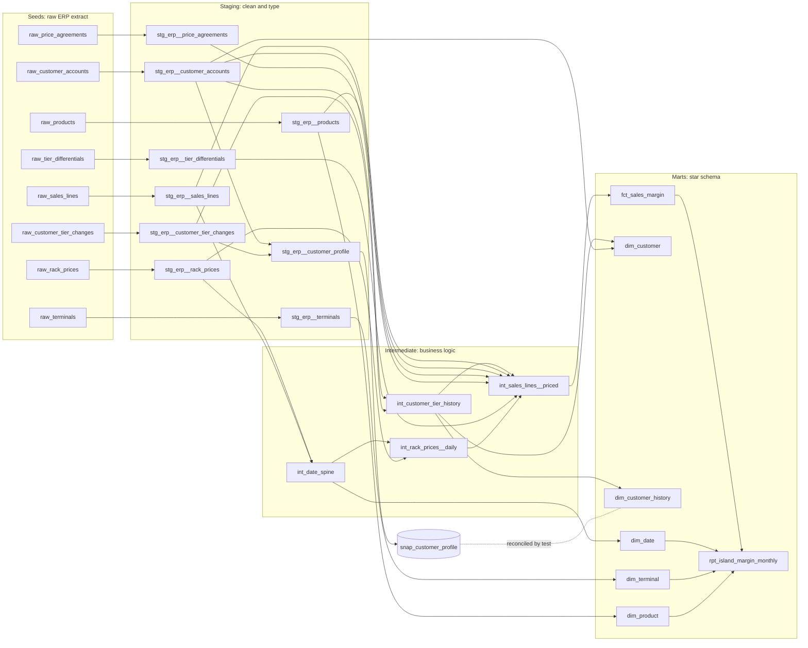

# Fuel Pricing Margin Model (dbt)

A dbt project that turns raw fuel distributor ERP data into a Kimball star schema for
margin and pricing analysis. It answers two questions a pricing team asks every day:

1. **What margin over rack did we earn on each sale**, by customer, product, terminal and island?
2. **Did we bill each customer what their price agreement says**, and where are the exceptions?

The design is based on pricing analytics I built for a Hawaii fuel distributor. **All data in this
repo is synthetic** (generated by `scripts/generate_seed_data.py`), so no company information is included.

## Run it in 2 minutes

```bash
pip install -r requirements.txt
dbt build --profiles-dir .        # loads seeds, builds every model, runs 68 tests
dbt docs generate --profiles-dir . && dbt docs serve --profiles-dir .
```

To see the snapshot record history, run it twice with the customer master replayed at two points in time:

```bash
dbt seed --profiles-dir .
dbt run --profiles-dir . -s stg_erp__customer_accounts stg_erp__customer_tier_changes
dbt snapshot --profiles-dir . --vars '{profile_as_of_date: 2026-01-01}'   # start of period
dbt snapshot --profiles-dir .                                             # after re-tiering
dbt build --profiles-dir .
```

Runs locally on DuckDB with no setup. To run on **Snowflake**, `pip install dbt-snowflake`, copy
`profiles.example.yml` to `~/.dbt/profiles.yml`, set the environment variables, and run
`dbt build --target snowflake`. The one warehouse-specific function (`regexp_replace`) is handled
with `adapter.dispatch` in `macros/clean_account_name.sql`.

## Lineage



## Star schema

| Model | Grain | Purpose |
|---|---|---|
| `fct_sales_margin` | one invoice line | gallons, revenue, rack price, expected price, margin and price variance |
| `dim_customer` | one customer across all operating companies | conformed customer with a stable cleaned name and current tier |
| `dim_customer_history` | one customer per price tier version | SCD Type 2: tier valid on `[valid_from, valid_to)` |
| `dim_product` | one product | product family (gasoline, diesel, jet, marine) |
| `dim_terminal` | one loading terminal | the island each terminal serves |
| `dim_date` | one day | calendar attributes, used for invoice date and rack publish date |
| `rpt_island_margin_monthly` | month x island x product family | the "margin by island" report |

## Design decisions

**Star schema instead of one wide reporting table.** A flat table per dashboard is faster to start,
but it copies the rack-price and pricing logic into every report, and margin numbers drift between
them. Here the pricing logic lives in one intermediate model, the fact table has a single clear grain,
and every report reuses the same measures.

**Conformed customer dimension.** The same customer holds accounts in several operating companies
under differently formatted names ("Pacific Paving LLC", "PACIFIC PAVING"). Accounts are cleaned in
staging and rolled up to one `customer_id`, so margin can be compared across companies.

**As-of rack prices resolved once.** Rack prices are published on business days only, but fuel sells
every day. `int_rack_prices__daily` carries the last published price forward for each day, terminal and
product (bounded to a 7-day lookback), and flags carried-forward rows. Doing this once avoids every
report re-implementing a weekend rule.

**Price tier history: snapshot and SCD Type 2.** About a third of customers are re-tiered during the
period, and the ERP overwrites the tier in place. Two complementary approaches keep history:

- `snap_customer_profile` is a **dbt snapshot** (timestamp strategy) on the overwrite-in-place customer
  master. It is how history gets captured going forward from a source that keeps none.
- `dim_customer_history` is an **SCD Type 2 dimension** rebuilt from the tier-change audit log, so it is
  fully reproducible on every run. A singular test proves the snapshot and the SCD2 history agree.

The pricing model joins each sale to the tier **in effect on the invoice date**
(`invoice_date >= valid_from and invoice_date < valid_to`). Joining to today's tier instead would
silently rewrite the expected price of past sales every time a customer is re-tiered, and would flag
241 correctly billed lines as billing exceptions.

**Pricing waterfall with `row_number()`.** A customer can have overlapping agreements. The most specific
one wins (product + terminal, then product, then customer-wide, then the tier default). Ranking candidate
agreements and keeping rank 1 guarantees one expected price per invoice line, and a test proves the fact
table never fans out.

## Tests

68 tests run on every build: `unique`, `not_null`, `relationships`, `accepted_values`, a custom
`non_negative` generic test, and four singular tests:

- `assert_fct_sales_margin_matches_source_lines` makes sure the fact table has exactly one row per deduplicated invoice line.
- `assert_margin_reconciles_to_variance` makes sure margin over rack equals contract margin plus billing variance on every line.
- `assert_customer_history_windows_are_valid` makes sure each customer has exactly one current tier and no empty validity windows.
- `assert_snapshot_agrees_with_scd2_history` makes sure the snapshot and the SCD2 dimension record the same tier versions.

GitHub Actions runs `dbt build` on every push and pull request (`.github/workflows/dbt-ci.yml`).

## Data quality issues handled

The synthetic generator plants issues that real ERP extracts have:

- duplicate invoice lines from re-extracts, kept to the latest `loaded_at` in staging
- messy account names with extra spaces, mixed case and legal suffixes, cleaned with a macro
- no rack prices on weekends, filled by the as-of model
- a small share of invoices billed off-contract, surfaced as `is_price_exception`
